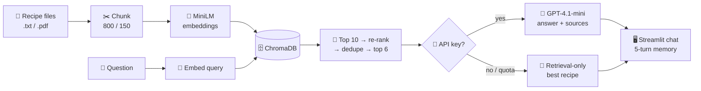

<div align="center">

# 🍛 Recipe RAG Chatbot

**Chat with your own recipe collection.**
Ask what to cook, and get answers grounded in your recipes, with the source named.

<p>
  
  
  
  
  
</p>

<sub>Course team project · <i>The Buzz Lightyears</i></sub>

</div>

---

## ✨ What it does

> **You:** How do I make butter chicken?
> **Bot:** Pulls the matching chunks from `butter_chicken.txt`, then walks you through the marinade, the gravy and the finish, citing the recipe it used.
>
> **You:** Can I make it less spicy?
> **Bot:** Remembers the conversation and adapts the same recipe.

<table>
  <tr>
    <td width="50%" valign="top">
      <h3>📥 Smart ingestion</h3>
      Loads <code>.txt</code> and <code>.pdf</code> recipes with LangChain, splits them into 800-character chunks with 150 overlap, and embeds them with <code>all-MiniLM-L6-v2</code>.
    </td>
    <td width="50%" valign="top">
      <h3>🎯 Retrieval + re-ranking</h3>
      Pulls the top 10 chunks from ChromaDB, boosts exact keyword and file-name matches, removes duplicates and keeps the best 6.
    </td>
  </tr>
  <tr>
    <td width="50%" valign="top">
      <h3>🧾 Grounded answers</h3>
      Every chunk is tagged with its source recipe, and GPT-4.1-mini is told to stay within that context and name the recipe it used.
    </td>
    <td width="50%" valign="top">
      <h3>🛟 Works offline too</h3>
      No API key or quota exceeded? The bot falls back to a retrieval-only answer showing the best-matching recipe instead of failing.
    </td>
  </tr>
</table>

## 🧠 How it works



## 🚀 Quick start

```bash
# 1. Set up
python -m venv .venv
source .venv/bin/activate            # Windows: .venv\Scripts\activate
pip install -r requirements.txt

# 2. (Optional) enable LLM answers
export OPENAI_API_KEY="your-key"     # Windows PowerShell: $env:OPENAI_API_KEY="your-key"

# 3. Build the index and launch
python ingest.py
streamlit run app.py
```

> 💡 **Add your own recipes:** drop `.txt` or `.pdf` files into `data/` and re-run `python ingest.py`.

## 📁 Project structure

```
recipe-rag-chatbot/
├── app.py            # 🖥️  Streamlit chat UI with session memory
├── rag.py            # 🎯  retrieval, re-ranking, prompt, LLM call, fallback
├── ingest.py         # 📥  load → chunk → embed → store in ChromaDB
├── config.py         # ⚙️  paths, model names, API key from environment
├── requirements.txt
└── data/             # 🍗  10 sample Indian chicken recipes
```

## 🍽️ Sample recipes included

`Butter Chicken` · `Hyderabadi Chicken Biryani` · `Chicken Tikka Masala` · `Chicken Chettinad` · `Chicken Korma` · `Chicken 65` · `Tandoori Chicken` · `Chicken Do Pyaaza` · `Dhaba Style Chicken Handi` · `Basic Chicken Curry`

## 🛠️ Tech stack

| Layer | Tool |
|---|---|
| UI | Streamlit |
| Document loading & chunking | LangChain (`PyPDFLoader`, `TextLoader`, `RecursiveCharacterTextSplitter`) |
| Embeddings | sentence-transformers · `all-MiniLM-L6-v2` |
| Vector store | ChromaDB (persistent, cosine similarity) |
| LLM | OpenAI · `gpt-4.1-mini` (temperature 0.4) |

## 🔭 Limitations & next steps

- [ ] **Evaluation:** add a labeled question set to measure how often the right recipe is retrieved (hit@k) and whether answers stay grounded
- [ ] **Re-ranking:** swap the keyword heuristic for a cross-encoder re-ranker
- [ ] **Scale:** the sample knowledge base is small (10 recipes), so this is a learning project rather than a benchmark

---

<div align="center">
<sub>Built by <a href="https://github.com/achux11">Achintya Vamshi Nudurupati</a> · <a href="https://linkedin.com/in/achintya11">LinkedIn</a></sub>
</div>
