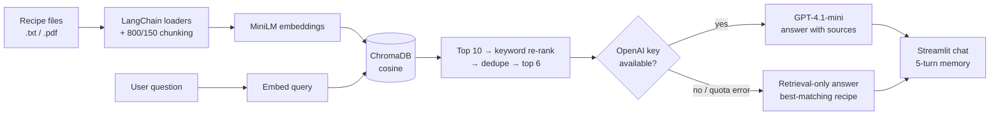

# Recipe RAG Chatbot

A conversational **Retrieval-Augmented Generation (RAG)** assistant that answers cooking questions from your own recipe files. Ask "how do I make butter chicken?" or "what can I cook with chicken and yogurt?", and it retrieves the most relevant recipe chunks and answers from them with the source recipe named.

Built as a course team project (team *The Buzz Lightyears*).



## Features

- **Ingestion pipeline**: loads PDF and text recipes with LangChain, splits them into 800-character chunks with 150 overlap, embeds them with `all-MiniLM-L6-v2`, and stores them in a persistent ChromaDB collection.
- **Retrieval with re-ranking**: pulls the top 10 chunks by vector similarity, then boosts chunks whose text or file name matches the query words, so "butter chicken" prefers `butter_chicken.txt` over generic chicken dishes.
- **Grounded answers**: the prompt tags each chunk with its source recipe and tells the model to stay within the context and name the recipe it used.
- **Conversation memory**: the last 5 turns go into the prompt, so follow-ups like "make it less spicy" work.
- **Graceful fallback**: if no API key is set or the OpenAI call fails (for example, quota exceeded), the app still returns the best-matching recipe text instead of an error.

## Tech stack

Python · Streamlit · LangChain (loaders, text splitter) · sentence-transformers · ChromaDB · OpenAI API (GPT-4.1-mini)

## Project structure

```
recipe-rag-chatbot/
├── app.py            # Streamlit chat UI with session memory
├── rag.py            # retrieval, re-ranking, prompt building, LLM call, fallback
├── ingest.py         # load → chunk → embed → upsert into ChromaDB
├── config.py         # paths, model names, API key from environment
├── requirements.txt
└── data/             # 10 sample recipe files
```

## Run it

```bash
python -m venv .venv
source .venv/bin/activate          # Windows: .venv\Scripts\activate
pip install -r requirements.txt

# optional: enables LLM answers (without it, the app runs in retrieval-only mode)
export OPENAI_API_KEY="your-key"   # Windows PowerShell: $env:OPENAI_API_KEY="your-key"

python ingest.py                   # builds the local chroma_db/ index
streamlit run app.py
```

Add your own recipes by dropping `.txt` or `.pdf` files into `data/` and re-running `python ingest.py`.

## Limitations and next steps

- The sample knowledge base is small (10 recipes), so this is a learning project, not a benchmark.
- There is no automated evaluation yet. A natural next step is a labeled question set that measures how often the correct recipe is retrieved (hit@k) and whether answers stay grounded.
- Keyword re-ranking is a simple heuristic; a cross-encoder re-ranker would be more robust.
